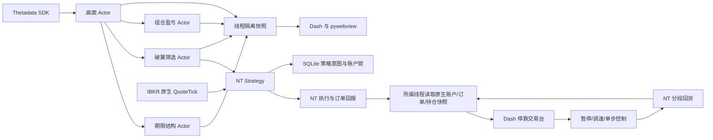

# 工程组织与数据流

交易台外观使用 MT5 的区域组织和 ATAS 深色配色，操作围绕期权到期日、Call / Put、行权价及多腿组合。`ui/terminal/combinations.py` 只构建并校验分析输入，复用现有 `PortfolioRequest` / 原生 PortfolioPnLActor；单组合及合计图直接显示 Actor 输出。分析草稿不是持仓或交易账本。原生持仓 / 委托的期权字段由所属线程从 NT OptionContract 读取，保留原始数量与价格。

`theme.py` 集中图表 / 表格主题，`rendering.py` 按浏览器对显示输出去重，隐藏 K 线 / 净值 / 曲面在激活时补齐；`charts.py` 复用当前回放时钟的显示 K 线，在聚合前排除未来报价。前端几何观察器只校正停靠后的 Plotly 尺寸，分隔线松开后调整图表。这些模块不改变 QuoteTick、委托处理或金融时钟。

```text
nautilus/
  src/qwork/
    actors/          # 四个独立 Actor 目录，各有 README
    strategies/     # 破翼蝴蝶规则、状态与原生委托
    analytics/      # IV、期限结构、候选与组合盈亏纯计算
    providers/      # Thetadata 官方 SDK、会话与采集
    core/           # 配置、模型、时间、线程隔离状态
    runtime/        # 研究和 IBKR 原生节点的装配、生命周期
    backtesting/    # 真实历史报价、合成组合价格、NT 回放与报告
    ui/             # Actor 分析界面和 terminal/ 独立停靠交易台
    cli.py          # terminal / dashboard / backtest / trade
  tests/            # 金融规则、原生节点、界面与策略回归
  scripts/          # Windows 安装和启动
  docs/             # 架构、验证与回测分析
  data/             # 忽略的历史缓存、回测、私有会话和验证产物
```



`analytics` 不连接网络、不发委托。`providers` 不访问 GUI。Actor 只在自身 Nautilus 事件循环发布结果；线程池完成后回到该循环。GUI 与策略共用数据契约，不直接操纵 NT 对象。原生节点与 Python Actor 在拥有它们的线程创建、运行和销毁。

研究界面默认不装配交易客户端。`trade` 单独启动明确账户的 IBKR 节点并注册四个 Actor，策略独立处理 QuoteTick 和成交回报。旧前后端及重复包已移出工作区；当前根目录只有此项目。

交易台默认没有账户连接，按用户操作启动无 Strategy 的账户监看节点、Actor 分析节点或原生回测线程。EA 使用独立 `qwork trade` 进程；关闭窗口不会强杀该进程。面板通过 FlexLayout 注册与停靠，表格使用 AG Grid。调速不修改金融时间，K 线从已到达报价聚合。界面来源始终区分真实账户、历史快照和回测模拟。

`ui/terminal/workflow.py` 统一研究 / 回放 / Paper / LIVE 上下文与控件权限；回测和 EA 配置独立。服务端启动审阅绑定账户及参数，90 秒过期且只可消费一次，最终启动再次检查新鲜账户数据。`presentation.py` 负责组合情景图和成交时刻检查，不维护订单或资金。缓存分析通过 SnapshotCollector 将明确的历史曲面送入现有原生 PortfolioPnLActor 与 TermStructureActor；交易工作区隔离历史曲面，回放不复用旧 IV。

策略的 `lifecycle.py` 管理共用订单超时 / 撤单 / 重试，`recovery.py` 保存意图及核验原生订单与逐腿仓位，`risk.py` 读取券商报告的净值和可用资金。SQLite 不替代 NT 成交账本。详细操作见 [交易台](../src/qwork/ui/terminal/README.md)，券商实测边界见 [实盘验收](live-readiness.md)。

`ui/terminal/reliability.py` 限制 K 线任务为单工作线程加一个最新待处理任务；请求代际阻止旧结果回写。进程注册文件仅保存启动参数与 PID / 创建时间，不保存订单、持仓或现金。服务重启只能恢复已登记且完整核验的后台监看，不能自动恢复券商连接或发委托。界面心跳独立于服务回调，服务中断时仍能显示冻结警告。折叠边栏先完成挂载再使用库动作折叠，以保持 Dash 跨面板状态完整；这些措施不替代券商执行验收。
